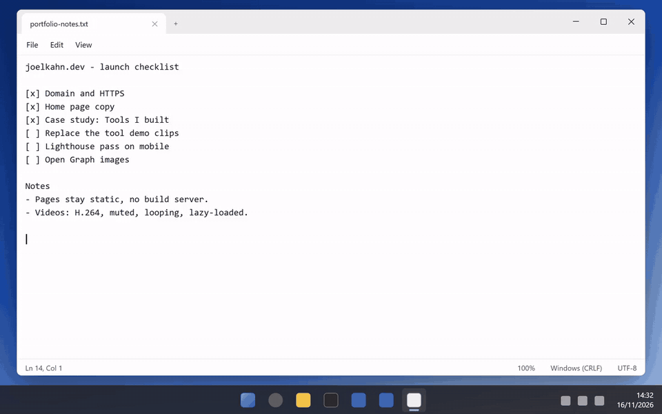

# WisperWin

Press a hotkey, talk, and your words are typed into whatever window you were in: local Whisper dictation for Windows.

- **Local, GPU-fast transcription** with [faster-whisper](https://github.com/SYSTRAN/faster-whisper) (large-v3 on an NVIDIA GPU by default). Audio never leaves your machine.
- **Your vocabulary:** a list of names and jargon that Whisper tends to mishear gets corrected after transcription.
- **Optional AI clean-up:** with your own Anthropic API key, the text is tidied (fillers, grammar, punctuation) and shaped for where you are pasting: a chat message, an email, an AI prompt, a document, or your own custom modes.



## Why I built it

I dictate a lot of messages and prompts. On Mac there are good dictation apps that run Whisper locally and paste the result anywhere; on Windows I couldn't find one that felt the same, and built-in dictation kept mangling product names and technical terms. WisperWin is the version I wanted: one hotkey, a small overlay with a live waveform, a vocabulary list for the words I actually use, and text that arrives already pasted.

## Requirements

- Windows 10 or 11
- Python 3.10 or newer
- A microphone
- **For the default `large-v3` model: an NVIDIA GPU with CUDA.** The CUDA runtime, cuBLAS and cuDNN come in as pip packages (`nvidia-*-cu12` in `requirements.txt`), so a separate CUDA Toolkit install is not needed, but you do need a recent NVIDIA driver. About 3 GB of free VRAM for large-v3.
- Without a GPU: set `model: small` or `distil-large-v3` in `config.yaml`. It will run on the CPU, but slower.
- Optional: an Anthropic API key for the AI clean-up step.

## Install

```powershell
git clone https://github.com/jkahn24/wisperwin.git
cd wisperwin
powershell -ExecutionPolicy Bypass -File setup.ps1
copy config.example.yaml config.yaml   # optional; edit to taste
```

`setup.ps1` creates a `venv` and installs `requirements.txt`. It uses the `py` launcher if present, else `python` on PATH; set the `PYTHON` environment variable to a full path to choose another one. The first dictation downloads the Whisper model (about 3 GB for large-v3) into your Hugging Face cache.

## Run

```powershell
venv\Scripts\pythonw.exe launcher.py
venv\Scripts\pythonw.exe wisperwin.py
```

or `restart.ps1`, which stops any running copy and starts both. `launcher.py` registers the global hotkey; `wisperwin.py` is the app (overlay and tray icon). With `startup_on_login: true` (the built-in default when there is no `config.yaml`) the app adds itself to your Startup folder. `uninstall.py` removes the Startup shortcut and, if you confirm, the downloaded Whisper model and the app folder. It leaves the API key in Credential Manager: remove the `WisperWin` entry there (or run `python -c "import keyring; keyring.delete_password('WisperWin', 'anthropic_api_key')"`).

## Hotkeys

| Key | Action |
|---|---|
| Ctrl+Space (configurable) | Start recording; press again to stop, transcribe and paste |
| Tray icon | Mode, vocabulary, settings, history, exit |

## Config

Settings live in `config.yaml` next to the code (see `config.example.yaml` for every key) and most can be changed from the tray icon's Settings window: hotkey, Whisper model, language, microphone, muting speakers while recording, clipboard auto-clear, idle model unload, vocabulary and custom clean-up modes.

**API key:** set it in Settings and it is stored in **Windows Credential Manager** (via the `keyring` package), not in a file. The `ANTHROPIC_API_KEY` environment variable also works and takes priority. If an old `config.yaml` has a plaintext `api_key`, WisperWin moves it into Credential Manager on start and blanks it in the file.

## Privacy

- **Audio is transcribed locally** and is never uploaded.
- **Text leaves your machine only for the optional AI clean-up step:** if an API key is set and the mode is not Raw, the transcript (and your vocabulary list) is sent to Anthropic's API (Claude Haiku). Clips under five words skip it. Without a key, or in Raw mode, nothing is sent anywhere.
- **Stored locally, in the app folder and git-ignored:** `history.json` (your last 50 dictations, plain text), `usage.json` (API token counts and estimated cost), `config.yaml`, and `unsent-audio/` (a recording is kept there only if transcription fails, so it can be recovered). Delete them whenever you like.
- The pasted text is put on the clipboard and cleared after `clipboard_ttl` seconds (default 30).
- Debug logs go to `%TEMP%\wisperwin_*.log`.

## Limitations

- Windows only.
- Built and tuned on one laptop (NVIDIA GPU, Bluetooth headset). Bluetooth headsets switch to a low-quality "hands-free" profile while the mic is open; WisperWin works around the common cases but your headset may behave differently.
- The AI clean-up uses Anthropic's API only, and costs a small amount per dictation on your own key.
- Auto-paste sends Ctrl+V to the window that was focused when you started; apps that block simulated keystrokes (some elevated or remote-desktop windows) will only get the text on the clipboard.
- The completion sound is optional: drop a `.wav` at `sounds/cowbell-sharp-hit.wav`; without it Windows plays its default sound.

## Tests

```powershell
python -m unittest discover tests -v
```

Standard library only; no venv needed.

## Licence

MIT, see [LICENSE](LICENSE).
